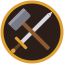

# Blacksmith Simulator



A small browser game written in TypeScript. Forge as many swords as you can in 60 seconds by striking the hot blade at just the right spot.

**Play it here:** https://vibecoding3.github.io/the-blacksmith/

## How to play

The menu bar on the left switches between the **Forge** (where you make items), your **Inventory** (where you equip them) and the **Trade Market** (where you sell them). Your gold is shown under the menu buttons. The forge pauses while you're in another menu or reading help.

| Key | Action |
| --- | --- |
| `A` / `←` | Move the marker left |
| `D` / `→` | Move the marker right |
| Mouse | Move the pointer left or right: the marker follows it |
| `Space` / click | Strike the blade (also starts a new round) |
| `S` / `↓` | Put the blade back in the forge to reheat it |
| `H` / **? Help** button | Open or close the help panel (pauses the game) |
| `I` / sidebar | `I` switches between **Forge** and **Inventory**; click the sidebar for any menu, including the **Trade Market** |

- The strike bar has the shape of the item you are forging (a sword for now). Steer the marker into the golden zone on the blade and strike. Only hits inside the zone count: a strike outside it ("Miss!") does nothing to the blade.
- **Hits and heats:** bigger items need more hits. A sword takes **5 hits over 2 heats**: 3 hits on the first heat, then you must put the blade back in the forge (S or ↓), then 2 more hits. The pips under the bar show your progress, with a flame between the heats. Swords hammered on hotter metal are worth more gold (up to 100g).
- **Inventory:** finished swords go to your inventory (24 slots) instead of being sold. Open **Inventory** to see them, click one to select it, then **Equip** it on your blacksmith.
- **Trade Market:** the place to sell. Select an item and press **Sell**, or use **Sell all normal** to sell every normal item at once (legendary items are kept). Equipped items can't be sold until you unequip them. Selling is the only way to earn gold. If the inventory is full, a newly forged sword is sold automatically. Your gold, items and equipment are saved in your browser.
- **Equipment:** for now you can equip one sword in the **Weapon** slot. Equipping another sword swaps them.
- **Item tiers:** every item you forge is either **Normal** or **★ Legendary**, revealed only when it's finished. The in-game help (**?** button or H) explains them.
- **Legendary swords:** every finished sword has a chance to turn out legendary, shown as the orange ★ stat under your energy (5% for now). You only find out when the sword is done. A legendary sword sells for 5× the normal price.
- **Energy:** you start each round with 100 energy, shown by the yellow lightning bolt under your sword count as current/maximum (e.g. 50/100). Every hammer swing costs 1 energy, whether it hits, misses or lands on cold metal. At 0 energy you can't forge any more and the round ends, even if time is left.
- The golden zone gets smaller with every sword you finish.
- **Heat:** the blade's temperature in °C is shown on the HEAT gauge on the right. The blade cools by about 30 °C per second in the air and 60 °C per strike.
  - Temperatures follow real steel forging: the forge brings the blade to a **yellow 1200 °C**, and it glows orange, then cherry red as it cools. The blade and gauge change colour to match.
  - Cooler metal is harder to work: the golden zone shrinks as the blade cools, and strikes are worth less.
  - Below **800 °C** (cherry red, the blue line) the steel is too cold to shape, and strikes do nothing. Real smiths stop hammering here because the steel can crack.
  - Press `S` or `↓` to reheat. The blade stays in the forge until it is fully hot, and you can't move or strike meanwhile. The colder it is, the longer this takes.
  - Each new sword starts fully hot.

## Display

The game renders at a fixed **1280×720** resolution and runs at up to **60 fps**, including on 120/144 Hz screens. In smaller browser windows it shrinks to fit while keeping its 16:9 shape.

## Running locally

Requires [Node.js](https://nodejs.org/) 22 or newer.

```sh
npm install
npm run dev      # start a dev server at http://localhost:5173/the-blacksmith/
npm run build    # type-check and build a static site into dist/
npm run preview  # serve the built dist/ folder
```

## Project layout

| Path | Purpose |
| --- | --- |
| `index.html` | Page and game canvas |
| `src/main.ts` | Game code: forging, menus, input, update loop and drawing |
| `src/items.ts` | Inventory, equipment and gold, saved in the browser |
| `public/favicon.svg` | Logo, used as the browser-tab icon and on the start screen |
| `VERSION` | Build number shown in the game |
| `vite.config.ts` | Build settings (GitHub Pages path, version injection) |
| `.github/workflows/deploy.yml` | Builds and publishes the game to GitHub Pages |

## Versioning

The build number is a single integer stored in the `VERSION` file. It goes up by one for every release (1, 2, 3, …). At build time it is shown in the bottom-right corner of the game as `vN`, so you can check which build you are playing.

To release a new version, increase the number in `VERSION`, then commit and push.

## Deployment

Every push to `main` runs the GitHub Actions workflow, which builds the game and publishes it to GitHub Pages. If the page still shows an old version number after a deploy finishes, refresh the page.

## Changelog

- **v18** – New **Trade Market** menu for selling items, with a **Sell all normal** button. Selling moved there from the Inventory, which is now for equipping.
- **v17** – Inventory system and a menu bar on the left with **Forge** and **Inventory**. Forged swords go to your inventory instead of being sold automatically; you choose what to equip or sell. Gold, items and equipment are saved between visits. The help button moved to the menu bar, and the per-round best score was removed.
- **v16** – Items need a set number of hits spread over heat cycles. A sword now takes 5 hits over 2 heats (3 + 2), with a required reheat in between. Clicking strikes exactly where you click.
- **v15** – Help button (**?**) in the top-right corner, also opened with H. It pauses the game and explains the controls and the item tiers (Normal and Legendary).
- **v14** – The energy counter shows your maximum as well (e.g. 50/100) and no longer turns red when low.
- **v13** – Fixed 1280×720 resolution (16:9) and a 60 fps frame cap.
- **v12** – The strike bar is now shaped like a sword (pommel, grip, crossguard and blade); the golden zone and marker stay on the blade.
- **v11** – Legendary swords: each finished sword has a 5% chance (shown as a ★ stat) to be legendary and sell for 5× the price, revealed when the sword is done.
- **v10** – Energy system: you start with 100 energy (yellow lightning bolt), each hammer swing costs 1, and the round ends when you run out.
- **v9** – Strikes outside the golden zone no longer count: they don't shape or cool the blade, and every one of the three hits must land in the zone.
- **v8** – Removed the perfect hit: any strike inside the golden zone counts the same, and the bright centre line is gone.
- **v7** – The marker follows the mouse pointer directly, with no speed limit (keys still move it at a fixed speed).
- **v6** – Steer the marker with the mouse as well as the keys. The marker slides toward the pointer at the same speed as with the keys.
- **v5** – Added the crossed hammer-and-sword logo as the browser-tab icon and on the start screen.
- **v4** – Realistic heat: the blade's temperature is tracked in °C (forged at 1200 °C, too cold below 800 °C) and shown next to the HEAT gauge, and the blade glows in real steel heat colours.
- **v3** – Heating system: the blade cools over time and with each strike, cooler metal has a smaller golden zone and earns less, and you reheat it in the forge with S or ↓.
- **v2** – You steer the marker yourself with A/D or the arrow keys. The version number is shown in-game. Added this README.
- **v1** – First release: the marker sweeps across the bar automatically and you strike when it is in the golden zone.
